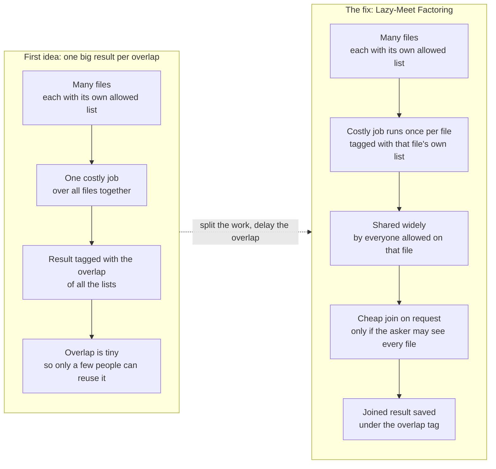
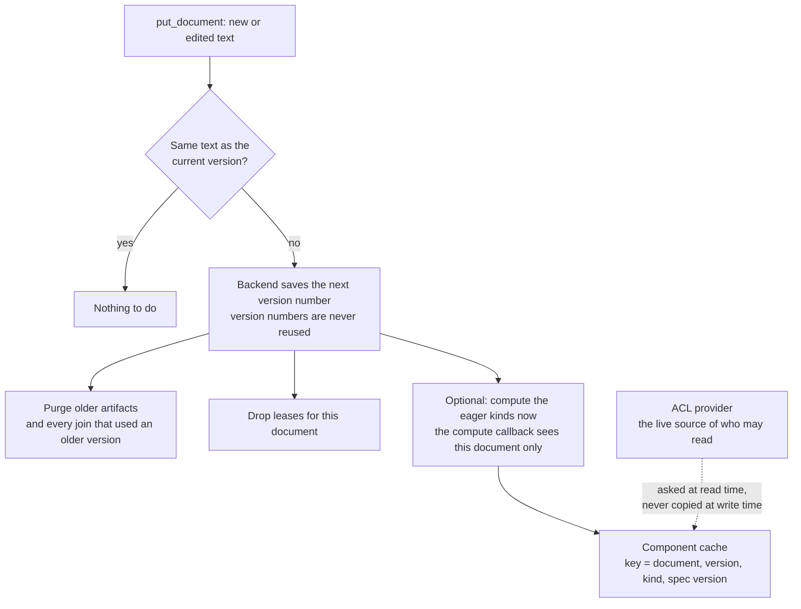
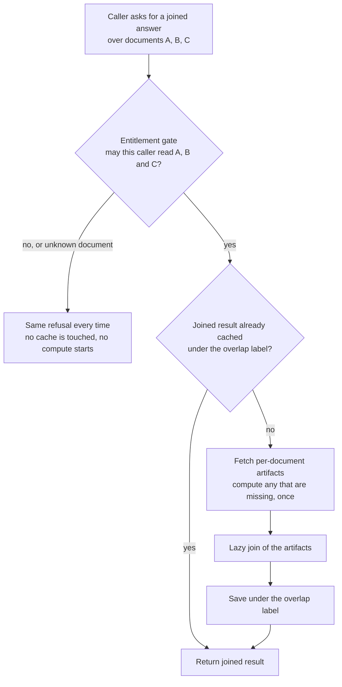
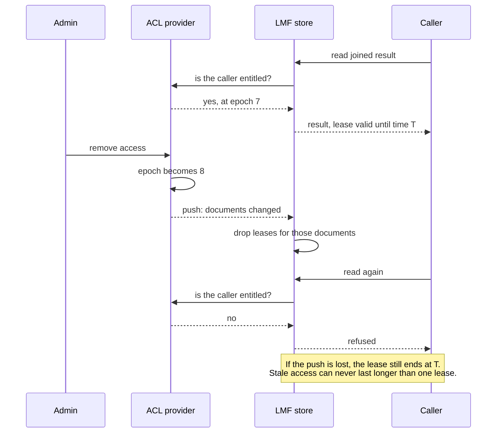
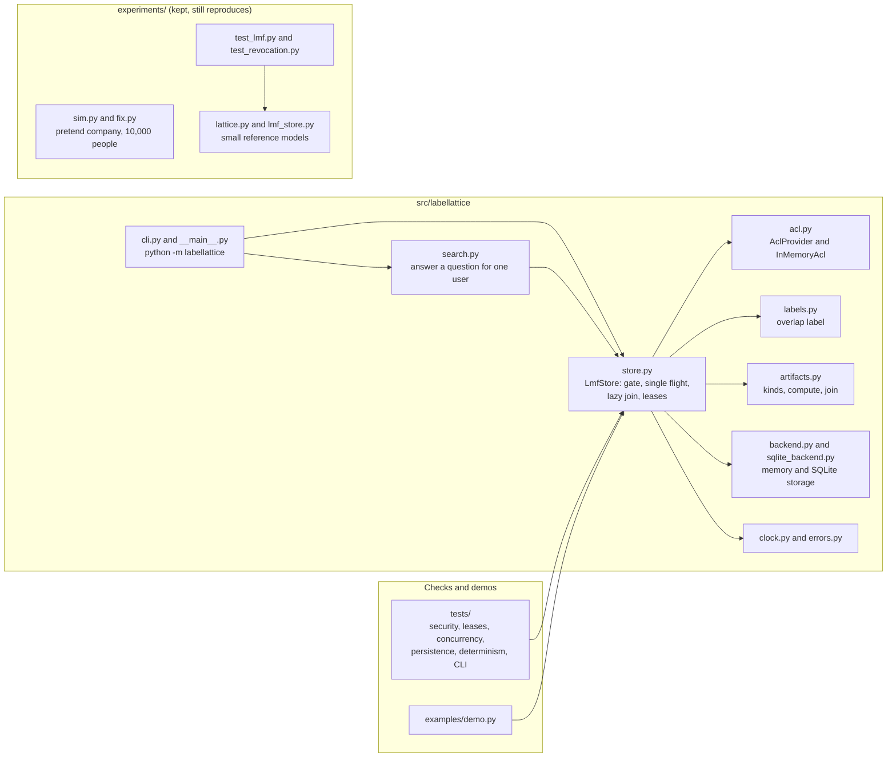

# Label Lattice

Share costly AI work between many users without sharing secrets.

This repo has two parts:

1. **A small working Python library**, `labellattice`, with a command line tool and a demo. It runs on your machine, has no dependencies, and makes no network calls.
2. **A simulation** in `experiments/` that tests the idea on a pretend company of 10,000 people. The numbers in the Results section come from it.

The idea is called Label-Lattice memoization with Lazy-Meet Factoring (LMF). The library is a real, tested implementation of the rules. Its AI parts are stand-ins. Read [What is real and what is simulated](#what-is-real-and-what-is-simulated) before you trust it with anything.

## The idea in plain words

### The problem

Picture a huge company with more than 10,000 workers. It has millions of files. Each worker is allowed to open only some of them.

Now add an AI helper. To answer a question, the helper reads files, writes summaries, and builds notes. This is slow and costly. If 500 people ask about the same file, the helper may do the same work 500 times.

The obvious fix is to save the work and reuse it. But that is risky. Say the helper writes a summary of a secret file for the boss. If it then shows that summary to an intern, a secret has leaked.

So we need a way to share work between people without sharing secrets.

### The first idea: label every result

Think of a library with colored keys. Every result the helper makes gets a tag. The tag says who may see it.

Here is the rule. If a result is built from several files, it gets the tag of the people who are allowed to see all of those files. That is the overlap of their permissions.

The helper does the work once. After that, anyone on the tag's list can reuse it. Anyone else cannot see it at all.

### The fix: do the work per file, then combine cheaply

We call the fix Lazy-Meet Factoring. It has three steps:

1. Do the slow, costly work once for each single file. Tag that piece with that file's own list of allowed people. These pieces are shared widely.
2. When someone asks for a combined result, check that they are allowed to see every file in it. If not, they get nothing.
3. If they are allowed, do a cheap join of the pieces. Save the joined result under the overlap tag, so the next allowed person can reuse it.

Think of baking. Before, we baked a whole cake for each small group. Now we bake each layer once and share it. We only stack the layers when someone orders the cake.

## Quick start

You need Python 3.11 or newer.

```bash
git clone https://github.com/mahimn01/label-lattice.git
cd label-lattice
python3 -m venv .venv && source .venv/bin/activate
pip install -e ".[dev]"
python -m pytest tests
python examples/demo.py
```

The demo ingests six documents, answers questions for five people, shows how much work is shared, and shows a revocation taking effect. It uses a fake clock, so the output is the same every run.

Try the command line tool:

```bash
rm -rf .ll-demo
python -m labellattice --home .ll-demo init
python -m labellattice --home .ll-demo acl add-user alice --groups all,legal
python -m labellattice --home .ll-demo acl add-user bob --groups all
python -m labellattice --home .ll-demo put memo --text "The merger closes in March." --groups legal
python -m labellattice --home .ll-demo put handbook --text "Work hours are nine to five." --groups all
python -m labellattice --home .ll-demo ask --as alice "When does the merger close?"
python -m labellattice --home .ll-demo ask --as bob "When does the merger close?"
python -m labellattice --home .ll-demo acl revoke alice legal
python -m labellattice --home .ll-demo read --as alice memo || echo "exit code $?"
```

Alice gets the answer. Bob is told there is nothing to find, and never learns the memo exists. After the revoke, Alice is refused too. A refusal prints `refused` and exits with code 3.

Use it as a library:

```python
from labellattice import InMemoryAcl, LmfStore, Refused

acl = InMemoryAcl()                                   # who may read what
acl.add_user("alice", {"all", "legal"})
acl.add_user("bob", {"all"})
acl.set_doc_acl("memo", {"legal"})
acl.set_doc_acl("handbook", {"all"})

store = LmfStore(acl)                                 # in memory; pass SqliteBackend("x.db") to keep it
store.put_document("memo", "The merger closes in March.")
store.put_document("handbook", "Work hours are nine to five.")

r = store.query("alice", ["memo", "handbook"])        # costly work per file, cheap join
print(r.label, r.source, [c["text"] for c in r.json()])

try:
    store.query("bob", ["memo", "handbook"])          # bob may not read the memo
except Refused as e:
    print("bob:", e)

acl.revoke_membership("alice", "legal")               # the push cuts access at once
try:
    store.query("alice", ["memo"])
except Refused:
    print("alice: refused after revoke")
```

To run the simulation tests too, install the extra packages with `pip install -e ".[dev,experiments]"` and run `python -m pytest`.

## What the library does

- **Documents with versions.** Each edit makes a new version. Old artifacts and joins are dropped when a new version arrives.
- **One costly job per document and version.** The job runs under that document's own access list. Its output is cached and shared by everyone who may read the document. Concurrent requests for the same job run it once.
- **Pluggable artifact kinds.** Three come built in: a claim list (the join is exact), a chunk note (the join is lossy), and a KV segment stand-in. You can register your own kind with your own compute and join functions, or pass one compute callback for all kinds.
- **A gate before any cache.** To read a joined result, the caller must be allowed to read every input. This check happens first. A refused caller causes no cache read, no compute, and no storage.
- **The same refusal for everything.** Not allowed, no such document, deleted document and missing version all raise the same `Refused("refused")`. The caller learns nothing from it.
- **A lazy join, cached under the overlap label.** The cache key is the kind plus the exact set of (document, version) pairs. Everyone with the same overlap shares the result.
- **Leases for revocation.** A change in the ACL pushes a notice that drops the affected leases at once. If the notice is lost, a lease still ends after `lease_s` seconds (30 by default). When a lease ends and nothing in the ACL has changed, a cheap epoch check renews it.
- **Two backends.** A thread-safe in-memory one and a SQLite file (standard library, WAL mode).
- **A pluggable ACL provider.** Subclass `AclProvider` and implement `can_read` and `epoch`. Add `subscribe` for push. `InMemoryAcl` is the reference one.

## How it works

The diagrams below match the code. Each has a one-line caption.

### The problem and the fix



*Caption: the costly work moves from the overlap to each single file, so it is shared widely.*

### The write path



*Caption: each document is processed alone, and what it makes is stored under that document's own version.*

### The read path



*Caption: the gate runs before any shared cache is read, so a refused caller learns nothing from hits or misses.*

### Revocation with ACL-epoch leases



*Caption: a push drops access at once, and a lease puts a hard time limit on access if the push is lost.*

### Code map



*Caption: the library is one small package. The simulation lives apart and does not import it.*

## What is real and what is simulated

Please read this part. We try not to overclaim.

**Real: code that runs, and tests that check it.**

| Property | How it is checked |
|---|---|
| The gate runs before any cache read, compute or storage | A counting backend and a counting compute callback show zero calls for refused callers |
| A refusal looks the same for every cause | Same exception type, text and call shape for not allowed, unknown, deleted, hot cache and cold cache |
| No payload ever names a document the caller cannot read | A random test mixes edits, ACL changes and all kinds, and checks every served payload |
| A push cuts access at once | Tests on the in-memory and SQLite backends |
| If the push is lost, staleness is at most one lease | A random test with a fake clock, with push on and off |
| A push that lands during a provider check leaves no lease behind | A test with a provider that revokes mid check |
| One compute per document and version under many threads | A slow compute with 16 threads, and stress tests with concurrent edits and revocations |
| Data survives a restart, and a tampered join row is not trusted | SQLite round trip tests |
| Same input gives the same bytes, in any order, thread timing or hash seed | Determinism tests, with a pinned digest |

**Stand-ins. Do not read more into these.**

- **The default compute is not an AI model.** It splits text into sentences and builds a claim list, a short note and a byte blob, using plain rules. The compute callback is where a real model would go.
- **The KV segment kind is a byte stand-in.** Nothing here patches a real KV cache. Whether a cheap join of per-document KV segments gives answers as good as one big pass is **not proven**. Neither is the quality of a joined summary. The claim list join is exact. The chunk note join is lossy by design.
- **The simulation data is made up.** The Results section comes from `experiments/` and not from the library. The library does not reproduce those numbers.
- **The ACL provider is in memory.** There is no adapter for a real identity system.

**Known limits of the working version.**

- Timing is not hardened. A refused call is cheap, and a hit is faster than a miss. An outside observer could try to time them.
- A caller who may read a result can see whether it came from the cache (`Result.source`). That tells them someone with the same overlap read it before. Set `expose_cache_status=False` to hide it.
- One process per SQLite file. The store keeps document metadata and leases in memory.
- The command line tool starts a fresh process each time, so there is no push between commands. It loads the ACL file each time, so changes apply to the next command.
- No cache size limit and no eviction yet.
- The library has had no outside security review. The tests are evidence, not a proof.

## The simulation

### What we tested

We built a pretend company on a computer. It had:

- 10,000 people
- 200,000 documents
- 5 million reads of documents
- 100,000 combined results, like summaries built from 2 to 8 files

We made up groups, teams, projects, and private files. We then changed the settings many times. For example, we changed how many files were private. We ran each setting 5 times with different random seeds.

We set a pass/fail rule before we started. If half or more of the reads only help a tiny group (3 people or fewer), the idea is too weak and we drop it.

### What we found

The first idea works well for single documents. It stays under the limit even when up to about 40 out of 100 files are private.

It breaks for combined results, like summaries built from many files. When you take the overlap of many permission lists, the group of allowed people gets small fast. With few private files, the idea passes, but only just. With 30 out of 100 files private, it fails. Most reads then help only a tiny group, so there is little to share.

## Results

The measure below is the share of reads that can be reused by only 3 people or fewer. Lower is better. The limit is 50%. These are averages over 5 runs. The "after" number also counts the cost of the join step.

| Pretend company | First idea | With the fix |
|---|---|---|
| Few private files (5 in 100) | 40.8%, passes barely | 10.3%, passes easily |
| Many private files (30 in 100) | 59.3%, fails | 27.5%, passes |
| Worst case we built (many small groups, 20% private, lots of one-off shares) | 65.5%, fails | 31.3%, passes |
| Half the files private (50 in 100) | 78.7%, fails | 50.3%, borderline |

Cost at 30 in 100 private files: the fix uses about 0.19 times the compute and storage of giving every person their own private cache. That is roughly one fifth.

## What the simulation did not prove

This list is about the simulation. The limits of the library are in the section above.

- **All data is made up.** The groups and permissions are synthetic. A real company will look different.
- **We did not measure join quality.** We assumed the cheap join gives a good answer. It is exact for lists of facts. It is only approximate for AI memory caches. It is lossy for summaries, because a summary can lose links between files.
- **The join cost is a guess.** We assumed how costly a join is. The fix stops paying off if a join costs about 1.5 to 2.5 times the work of one chunk. Real costs may differ.
- **It still fails when most files are private.** At 50 to 60 in 100 private files, the fix is borderline or fails.
- **A small leak remains.** If a result comes back fast, a person who is allowed to see it can guess that another allowed person read it recently. They learn nothing about the content, but they learn that someone looked.
- **We left things out.** Our simulation has no real model, no cache size limits, and no file edits over time (apart from unit tests).

## Has anyone done this?

We searched for prior work. We did not find anyone who has built the whole thing. Parts of it exist. These are the closest works we found:

- **AkasicMEM**, a paper on governed memory for company AI agents. It also uses the overlap of permissions for derived memories. [arXiv 2609.25563](https://arxiv.org/abs/2609.25563)
- **Tessera (UCSC)**, a paper on sharing AI memory caches across requests. It only sketches permissions. [arXiv 2609.32999](https://arxiv.org/abs/2609.32999)
- **Tessera (hackathon demo)**, a small open source demo of a cache with per-section permissions. [github.com/hectar-glitches/tessera](https://github.com/hectar-glitches/tessera)
- **FIDES from Microsoft**, a paper on tracking who may see AI agent data using the same overlap rule. It has no caching. [arXiv 2505.23643](https://arxiv.org/abs/2505.23643)

We do not claim more than what is in [PRIOR_ART.md](PRIOR_ART.md). That file lists everything we found and what each work does and does not cover.

## Running the simulation

```bash
pip install -e ".[dev,experiments]"
cd experiments
python -m pytest test_lmf.py test_revocation.py
python run_fix.py && python make_fix_report.py
```

The last command re-makes the results for the fix. It reuses the saved runs in `runs_fix/`, so it takes seconds. To recompute everything from scratch, delete `runs/` and `runs_fix/` and run `python run_all.py` and `python run_fix.py`. That took us about 7 minutes and 4 minutes on a multi-core machine.

## Where things are

| Path | What it is |
|---|---|
| `src/labellattice/` | The library |
| `src/labellattice/store.py` | The store: gate, single flight, lazy join, leases |
| `src/labellattice/acl.py` | The ACL provider interface and an in-memory provider |
| `src/labellattice/artifacts.py` | Artifact kinds, the default compute, the joins |
| `src/labellattice/backend.py`, `sqlite_backend.py` | Memory and SQLite storage |
| `src/labellattice/search.py`, `cli.py` | A small question answerer and the command line tool |
| `tests/` | Tests for the library |
| `examples/demo.py`, `examples/docs/` | The demo and its six documents |
| `.github/workflows/ci.yml` | Runs the tests on Python 3.11, 3.12 and 3.13 |
| `experiments/` | The simulation, its reference models, tests, saved runs and write-ups |
| `experiments/RESULTS.md`, `experiments/FIX.md` | Write-ups of the first idea and of the fix |
| `PRIOR_ART.md` | Who else has done something similar |
| `docs/long-context-research.md` | The earlier research report that led to this idea |

## Next steps

1. Plug in a real model for the compute callback. Measure join quality for facts, memory caches and summaries against doing the work in one piece.
2. Test with a real company's permission exports, so the groups and private files are real.
3. Measure the true join cost, and check the break-even point.
4. Handle the fast-hit leak, for example with timing noise.
5. Add a cache size limit, and an ACL provider for a real identity system.
