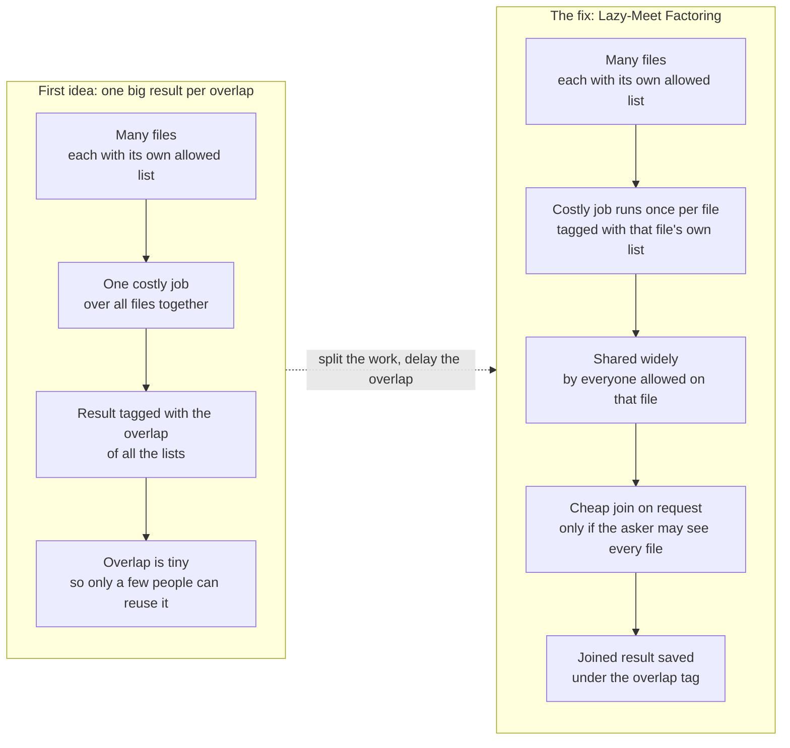
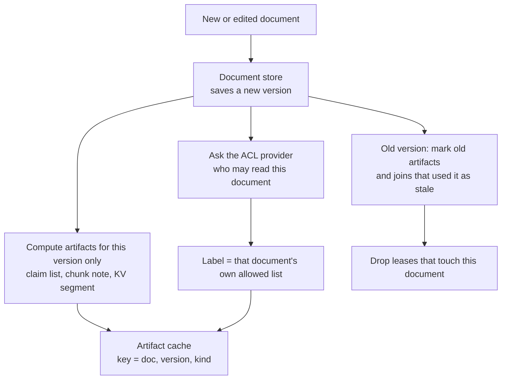
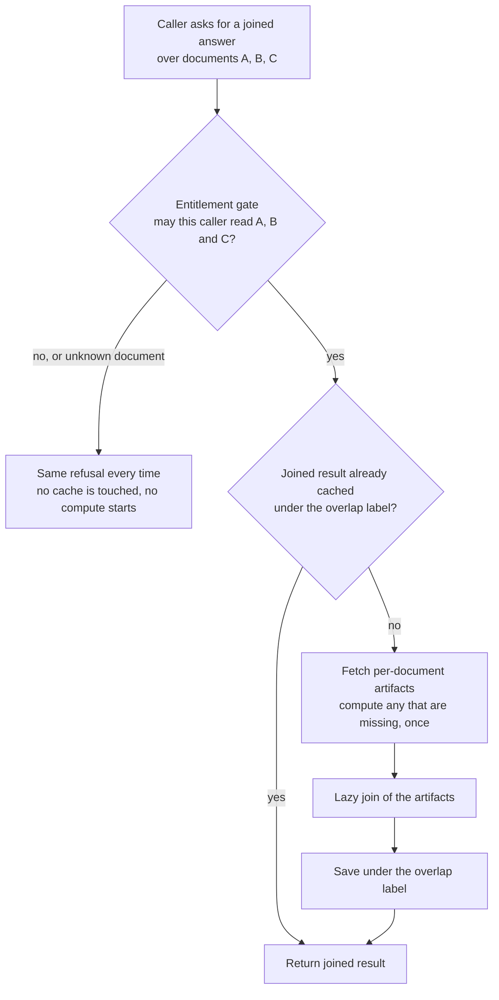
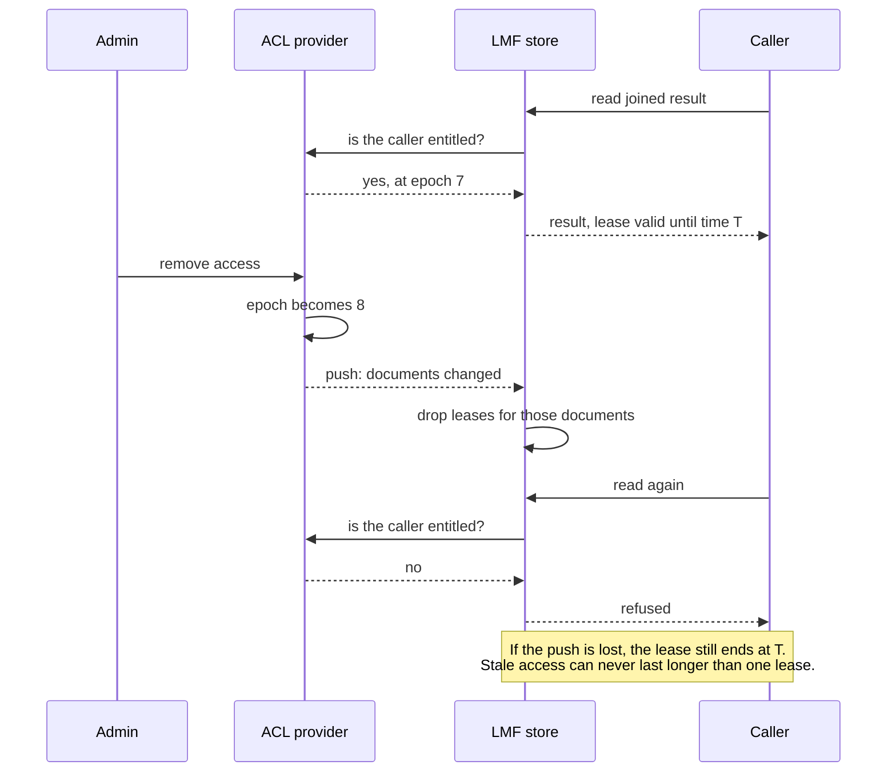
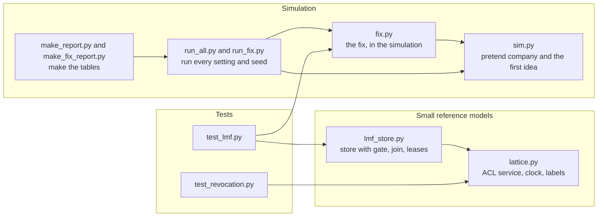

# Label Lattice

## What is this?

This project asks one question. Can an AI helper serve thousands of workers at a huge company, share its expensive work between them, and still keep every secret safe? We built a pretend company on a computer to find out. This repo holds the code, the results, and our notes. It is a simulation with made-up data. It is not a finished product.

## The problem in plain words

Picture a huge company with more than 10,000 workers. It has millions of files. Each worker is allowed to open only some of them.

Now add an AI helper. To answer a question, the helper reads files, writes summaries, and builds notes. This is slow and costly. If 500 people ask about the same file, the helper may do the same work 500 times.

The obvious fix is to save the work and reuse it. But that is risky. Say the helper writes a summary of a secret file for the boss. If it then shows that summary to an intern, a secret has leaked.

So we need a way to share work between people without sharing secrets.

## The first idea: label every result

Think of a library with colored keys. Every result the helper makes gets a tag. The tag says who may see it.

Here is the rule. If a result is built from several files, it gets the tag of the people who are allowed to see all of those files. That is the overlap of their permissions.

The helper does the work once. After that, anyone on the tag's list can reuse it. Anyone else cannot see it at all.

## What we tested

We built a pretend company on a computer. It had:

- 10,000 people
- 200,000 documents
- 5 million reads of documents
- 100,000 combined results, like summaries built from 2 to 8 files

We made up groups, teams, projects, and private files. We then changed the settings many times. For example, we changed how many files were private. We ran each setting 5 times with different random seeds.

We set a pass/fail rule before we started. If half or more of the reads only help a tiny group (3 people or fewer), the idea is too weak and we drop it.

## What we found

The first idea works well for single documents. It stays under the limit even when up to about 40 out of 100 files are private.

It breaks for combined results, like summaries built from many files. When you take the overlap of many permission lists, the group of allowed people gets small fast. With few private files, the idea passes, but only just. With 30 out of 100 files private, it fails. Most reads then help only a tiny group, so there is little to share.

## The fix: do the work per file, then combine cheaply

We call the fix Lazy-Meet Factoring. It has three steps:

1. Do the slow, costly work once for each single file. Tag that piece with that file's own list of allowed people. These pieces are shared widely.
2. When someone asks for a combined result, check that they are allowed to see every file in it. If not, they get nothing.
3. If they are allowed, do a cheap join of the pieces. Save the joined result under the overlap tag, so the next allowed person can reuse it.

Think of baking. Before, we baked a whole cake for each small group. Now we bake each layer once and share it. We only stack the layers when someone orders the cake.

## Architecture in pictures

These diagrams show the design. Each one has a one-line caption.

### 1. The problem and the fix



*Caption: the costly work moves from the overlap to each single file, so it is shared widely.*

### 2. The write path



*Caption: each document is processed alone, and every piece it makes carries only that document's label.*

### 3. The read path



*Caption: the gate runs before any shared cache is read, so a refused caller learns nothing from hits or misses.*

### 4. Revocation with ACL-epoch leases



*Caption: a push drops access at once, and a lease puts a hard time limit on access if the push is lost.*

### 5. Code map



*Caption: the code is a simulation plus two small reference models, and tests cover both.*

## Results

The measure below is the share of reads that can be reused by only 3 people or fewer. Lower is better. The limit is 50%. These are averages over 5 runs. The "after" number also counts the cost of the join step.

| Pretend company | First idea | With the fix |
|---|---|---|
| Few private files (5 in 100) | 40.8%, passes barely | 10.3%, passes easily |
| Many private files (30 in 100) | 59.3%, fails | 27.5%, passes |
| Worst case we built (many small groups, 20% private, lots of one-off shares) | 65.5%, fails | 31.3%, passes |
| Half the files private (50 in 100) | 78.7%, fails | 50.3%, borderline |

Cost at 30 in 100 private files: the fix uses about 0.19 times the compute and storage of giving every person their own private cache. That is roughly one fifth.

## What we have not proven yet

Please read this list. It matters.

- **All data is made up.** The groups and permissions are synthetic. A real company will look different.
- **We did not measure join quality.** We assumed the cheap join gives a good answer. It is exact for lists of facts. It is only approximate for AI memory caches. It is lossy for summaries, because a summary can lose links between files.
- **The join cost is a guess.** We assumed how costly a join is. The fix stops paying off if a join costs about 1.5 to 2.5 times the work of one chunk. Real costs may differ.
- **It still fails when most files are private.** At 50 to 60 in 100 private files, the fix is borderline or fails.
- **A small leak remains.** If a result comes back fast, a person who is allowed to see it can guess that another allowed person read it recently. They learn nothing about the content, but they learn that someone looked.
- **We left things out.** Our simulation has no real model, no cache size limits, and no file edits over time (apart from unit tests).

## Has anyone done this?

We searched for prior work. We did not find anyone who has built the whole thing. Parts of it exist. These are the closest works we found:

- **AkasicMEM**, a paper on governed memory for company AI agents. It also uses the overlap of permissions for derived memories. [arXiv 2609.25563](https://arxiv.org/abs/2609.25563)
- **Tessera (UCSC)**, a paper on sharing AI memory caches across requests. It only sketches permissions. [arXiv 2609.32999](https://arxiv.org/abs/2609.32999)
- **Tessera (hackathon demo)**, a small open source demo of a cache with per-section permissions. [github.com/hectar-glitches/tessera](https://github.com/hectar-glitches/tessera)
- **FIDES from Microsoft**, a paper on tracking who may see AI agent data using the same overlap rule. It has no caching. [arXiv 2505.23643](https://arxiv.org/abs/2505.23643)

We do not claim more than what is in [PRIOR_ART.md](PRIOR_ART.md). That file lists everything we found and what each work does and does not cover.

## How to run it

You need Python 3.

```bash
pip install -r requirements.txt
python -m pytest test_lmf.py test_revocation.py
python run_fix.py && python make_fix_report.py
```

The last command re-makes the results for the fix. It reuses the saved runs in `runs_fix/`, so it takes seconds. To recompute everything from scratch, delete `runs/` and `runs_fix/` and run `python run_all.py` and `python run_fix.py`. That took us about 7 minutes and 4 minutes on a multi-core machine.

## Where things are

| File | What it is |
|---|---|
| `sim.py` | Builds the pretend company and runs the first idea |
| `lattice.py` | The permission label (overlap) logic |
| `run_all.py` | Runs all the first-idea settings and seeds |
| `make_report.py` | Turns `results.json` into `tables.md` |
| `RESULTS.md` | Write-up of the first-idea results |
| `PRIOR_ART.md` | Who else has done something similar |
| `fix.py` | The fix, Lazy-Meet Factoring, in the simulation |
| `lmf_store.py` | A small working store that follows the fix's rules |
| `run_fix.py` | Runs the fix over the same settings |
| `make_fix_report.py` | Turns `results_fix.json` into `fix_tables.md` |
| `FIX.md` | Write-up of the fix and the options we compared |
| `fix_tables.md` | Full before and after tables |
| `test_revocation.py` | Tests that removing access works |
| `test_lmf.py` | Tests that the fix never leaks and stays correct |
| `results.json`, `results_fix.json` | Summary numbers |
| `runs/`, `runs_fix/` | Saved result of each single run (small, about 2 MB total) |
| `requirements.txt` | Python packages needed |
| `docs/long-context-research.md` | The earlier research report that led to this idea |

## Next steps

1. Test with a real company's permission exports, so the groups and private files are real.
2. Measure join quality: how good are the joined answers for facts, memory caches, and summaries compared with doing the work in one piece?
3. Measure the true join cost, and check the break-even point.
4. Handle the fast-hit leak, for example with timing noise or by limiting who can see hit signals.
